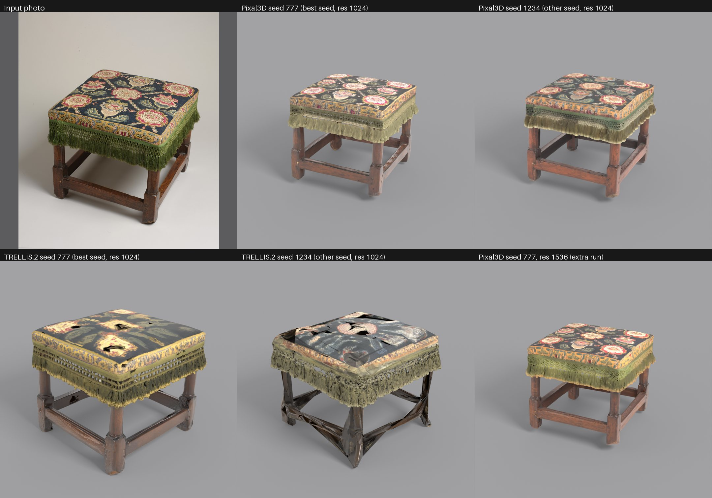

# comfyui-image-to-3d

One photo of a piece of furniture in, a textured GLB (PBR maps + UV) out, in ComfyUI, with two models side by side:
**Pixal3D** (TencentARC) and **TRELLIS.2** (Microsoft). This is the reproducible pack behind our case study
"Furniture photo to 3D" and the YouTube video about it.

- Case page: https://grawwww.xyz/en/work/furniture-3d/
- Video: https://youtu.be/98btVDZIK7U



The honest summary (details and failures in [results/RESULTS.md](results/RESULTS.md)): on the stool, Pixal3D worked and TRELLIS.2
shattered it with both seeds we tried; on the chair the two are close and neither keeps the cane weave. Two photos, two seeds
each: this is a test log, not a benchmark. The models are the int8 ConvRot ComfyUI repacks, not the official full-precision pipelines.

## What is in the repo

| Path | What |
|---|---|
| `workflows/pixal3d_image_to_3d.json`, `workflows/trellis2_image_to_3d.json` | UI-format workflows: drag into ComfyUI. Our settings: upsample 1024, textures 2048, 150k and 50k decimation branches, seed 777 |
| `workflows/*.api.json` | The same graphs in API format, exactly what `gen3d.py` submits |
| `scripts/gen3d.py` | CLI: builds the graph, runs it through the ComfyUI HTTP API, downloads the GLBs, appends timings/VRAM to a CSV. Python standard library only |
| `scripts/render.sh`, `render_glb.py` | Blender 4.5 headless: stills, turntable frames, wireframe, UV layout |
| `scripts/compare_sheet.py` | Photo / Pixal3D / TRELLIS.2 comparison sheet (needs Pillow) |
| `scripts/fetch_models.sh` | Downloads the pinned model files from Hugging Face and verifies size and sha256 |
| `scripts/validate_workflow.py` | Checks the workflows against a running ComfyUI without generating anything |
| `scripts/make_workflows.py`, `api_to_ui.py` | Regenerate the workflow JSONs from the Python graph |
| `inputs/` | The two CC0 test photos |
| `results/` | `runs.csv` (10 runs), `graphs/` (the API graph of every run), `RESULTS.md`, comparison sheets |

No model weights and no generated meshes are in the repo.

## Requirements (pinned)

| Thing | Version |
|---|---|
| ComfyUI | **0.37.0** (native Pixal3D / TRELLIS.2 nodes; frontend 1.52.7, `comfyui-workflow-templates` 0.11.66) |
| GPU | One 24 GB NVIDIA card (we used an RTX 4090). Numbers below are from that card |
| Blender (renders only) | **4.5.14** (stock, headless; Cycles, GPU optional) |
| Python | 3.x for `gen3d.py` (stdlib only; tested with 3.14), Pillow for `compare_sheet.py` |
| ffmpeg | optional, only for `turntable_mp4.sh` |

Model files, put in `ComfyUI/models/<folder>/`. `scripts/fetch_models.sh` downloads and checks them. Sizes in bytes.

| Folder / file | Bytes | sha256 | URL |
|---|---|---|---|
| `diffusion_models/pixal3d_int8_convrot.safetensors` | 5584555824 | `4621eac3b715484f79303c7152af641fe0b2b14f4d0e3d394fd6922d00f955ec` | https://huggingface.co/Comfy-Org/Pixal3D/resolve/main/diffusion_models/pixal3d_int8_convrot.safetensors |
| `diffusion_models/trellis_2_int8_convrot.safetensors` | 5253048192 | `d01952ad137213f6a868f86b6b877026276f84af5eec23069217475a0bad3a31` | https://huggingface.co/Comfy-Org/TRELLIS.2/resolve/main/diffusion_models/trellis_2_int8_convrot.safetensors |
| `clip_vision/dino_v3_L_naf_fp32.safetensors` (DINOv3 ViT-L + NAF, **Meta licence**) | 1215214176 | `4ad2ec4e0879a5b5b04cd97325cc37da954a7b6edca5170b86510f17f2b2290f` | https://huggingface.co/Comfy-Org/Pixal3D/resolve/main/clip_vision/dino_v3_L_naf_fp32.safetensors |
| `vae/trellis_2_shape_vae_bf16.safetensors` | 1095844024 | `de0cb4949a76c59ee5c091a995a69bcc8c51d5aeda939f0c641a50d2a72341f4` | https://huggingface.co/Comfy-Org/TRELLIS.2/resolve/main/vae/trellis_2_shape_vae_bf16.safetensors |
| `vae/trellis_2_texture_vae_bf16.safetensors` | 948461364 | `714e5ebf094a610e12a8e3b5175c18a62f37f6ea4218acb6073644456b73ab0e` | https://huggingface.co/Comfy-Org/TRELLIS.2/resolve/main/vae/trellis_2_texture_vae_bf16.safetensors |
| `geometry_estimation/moge_2_vitl_normal_fp16.safetensors` (MoGe-2, Pixal3D only) | 661859924 | `cb1a692d03235671e959e81360d7b4d9f44aefadb1f852d6ca6aa17799d5e31f` | https://huggingface.co/Comfy-Org/MoGe/resolve/main/geometry_estimation/moge_2_vitl_normal_fp16.safetensors |
| `background_removal/birefnet.safetensors` (BiRefNet) | 444473596 | `9ab37426bf4de0567af6b5d21b16151357149139362e6e8992021b8ce356a154` | https://huggingface.co/Comfy-Org/BiRefNet/resolve/main/background_removal/birefnet.safetensors |

Use the int8 files. We did not use the bf16 Pixal3D checkpoint (it hit an open ComfyUI crash, issue #16056).
Total download: about 9.2 GB.

## Run it

```bash
# 1. models (accept the DINOv3 licence first, see "Credits and licences")
scripts/fetch_models.sh /path/to/ComfyUI/models

# 2. start ComfyUI 0.37.0 as usual (default http://127.0.0.1:8188), then:
export COMFY_URL=http://127.0.0.1:8188
python3 scripts/validate_workflow.py          # no GPU: node types, inputs, model names, UI <-> API round trip

# 3. generate (GPU). Pixal3D, the stool, seed 777:
python3 scripts/gen3d.py --model pixal3d --image inputs/stool_met_c1670.jpg --seed 777 --res 1024 --out runs/stool_pixal3d_s777
# same photo with TRELLIS.2:
python3 scripts/gen3d.py --model trellis2 --image inputs/stool_met_c1670.jpg --seed 777 --res 1024 --out runs/stool_trellis2_s777
```

Output in `--out`: `*_hi_*.glb` (about 150k triangles), `*_lo_*.glb` (about 50k), a UV atlas PNG, `graph_api.json`, `history.json`, `run.json`.
One row per run is appended to `runs.csv` (seconds, peak VRAM of the whole card from `nvidia-smi`, triangle counts, texture sizes).

Options: `--res` upsample target (1024..2048 in steps of 128; default 1024), `--tex` texture size (2048), `--faces-hi 150000`,
`--faces-lo 50000`, `--seed`, `--csv`, `--dump-graph` (write the graph only, no server needed). Environment: `COMFY_URL`,
`COMFY_CONTAINER` (optional Docker container name: enables RAM sampling through `docker stats`).

**Or in the ComfyUI UI:** copy the photo to `ComfyUI/input/`, drag `workflows/pixal3d_image_to_3d.json` (or the TRELLIS.2 one)
onto the canvas, run. The UI workflows are made for the stool at seed 777; change the image and the seeds in the nodes.
Both workflows also save a UV atlas preview.

### Rendering with Blender

```bash
export BLENDER=/path/to/blender-4.5.14/blender     # or have `blender` on PATH
scripts/render.sh runs/stool_pixal3d_s777/<hi>.glb out/stills stills 0 1080 64 -35   # front, q34, side, rear, top
scripts/render.sh runs/stool_pixal3d_s777/<hi>.glb out/turn   turn   0 1080 48 -35 144   # 144 frames, 360 degrees
scripts/render.sh runs/stool_pixal3d_s777/<lo>.glb out/wire   wire   0 1080 16 -35       # wireframe of the 50k mesh
scripts/render.sh runs/stool_pixal3d_s777/<hi>.glb out/uv     uv                          # UV layout PNG
scripts/turntable_mp4.sh out/turn out/turntable.mp4
```
Arguments after the mode: front azimuth, size, samples, level (pitch), frames.

**Camera-space meshes (manual step).** Pixal3D meshes come out in the photo's camera frame, tilted by the camera pitch, so they must be
levelled before a clean render. We did it by eye with `test` mode: -35 degrees (stool) and -25 degrees (chair) about X. TRELLIS.2 meshes
come out upright and only needed a turn about Z (45 and 300 degrees) to match the photo angle. Pixal3D's camera angle comes from MoGe-2
(25.05 degrees on the stool, 50.74 on the chair), so this could be automated; we did not.

## Time and VRAM on a 24 GB card (RTX 4090, from `results/runs.csv`)

Res 1024. VRAM is the whole-card peak (about 2.1 GB was already used by other processes).

| Photo | Model | Seconds (2 seeds) | VRAM peak (GB) |
|---|---|---|---|
| stool | Pixal3D | 124, 135 | 12.7, 11.2 |
| stool | TRELLIS.2 | 252, 215 | 18.2, 18.5 |
| chair | Pixal3D | 70, 72 | 10.1, 9.7 |
| chair | TRELLIS.2 | 56, 52 | 10.0, 10.1 |
| stool | Pixal3D, res 1536 | 215 | 15.6 |

TRELLIS.2 at res 1536 was not tried (18.5 GB at 1024 leaves no safe room on 24 GB). A GLB is 12-29 MB (three 2048 PNG maps inside).
Container RAM peaked around 7-12 GB (sampled with `docker stats`, includes the model cache). No claim for smaller cards: not tested.

## Known failures (full list in [results/RESULTS.md](results/RESULTS.md))

- TRELLIS.2 on the stool: shattered stretchers, torn seat with holes, washed-out embroidery, with both seeds.
- Cane weave becomes a solid plate on the chair, with both models; legs come out lumpy, with flared or cut ends.
- Hidden sides are invented (rear of the stool, underside of the chair seat).
- Pixal3D output must be levelled by hand (above). Metallic bake too high on non-metal parts.
- Higher resolution helped the stool and did not help the chair (res 1536 was worse there).
- The GPU UV unwrap yields thousands of tiny charts, and the 50k mesh has irregular triangles: not production topology.
- Not tested: glass/chrome, watertightness, real-world dimensions, multi-view input.

## Credits and licences

- This repo's own code and text: MIT, see `LICENSE` (Copyright (c) 2026 Grawwww).
- The workflow JSONs derive from the template bundled with ComfyUI (`comfyui-workflow-templates` 0.11.66, MIT, Copyright (c) 2023-present Comfy Org): see `NOTICE.md`.
- Pixal3D: TencentARC, MIT. https://github.com/TencentARC/Pixal3D
- TRELLIS.2: Microsoft, MIT. https://github.com/microsoft/TRELLIS.2
- BiRefNet: MIT. MoGe-2: MIT (Microsoft).
- **Built with DINOv3.** Both models use DINOv3 features. The DINOv3 weights are **not** included here and are under the
  Meta DINOv3 licence (https://ai.meta.com/resources/models-and-libraries/dinov3-license), not MIT. Download them yourself and follow that licence
  (commercial use is allowed; no redistribution without the licence and the "Built with DINOv3" notice; no military, weapons or ITAR uses).
- Input photos: stool, The Metropolitan Museum of Art (CC0, Met Open Access); chair, Antonio Borrillo (CC0). Details in `NOTICE.md`.
- Generated meshes are AI-generated content; label them as such where the law requires it.
- Not legal advice. Full third-party notes in `NOTICE.md`.

Questions or a job like this: hello@grawwww.xyz
