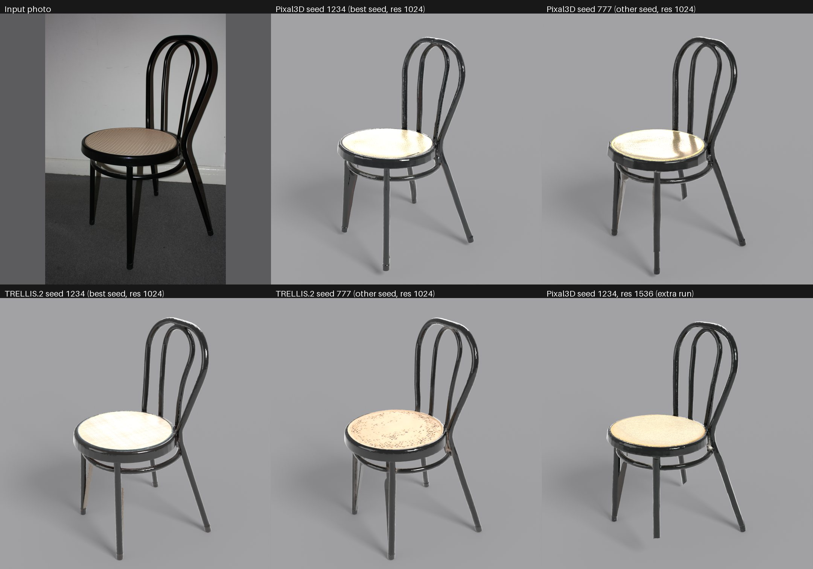

# Results: one furniture photo to textured GLB, Pixal3D vs TRELLIS.2

Run on 2026-10-15, ComfyUI 0.37.0, one RTX 4090 (24 GB), int8 ConvRot repacks (not the official pipelines).
Numbers are from `runs.csv`, written by `scripts/gen3d.py`; the graph of every run is in `graphs/`. Judgements about quality
come from looking at the renders: they are not metrics. n = 2 seeds per cell and 2 photos, so no statistics.

## Settings
BiRefNet matte, crop 1024 (padding 1.1 for Pixal3D, 1.0 for TRELLIS.2), for Pixal3D the horizontal FOV from MoGe-2, DINOv3-L + NAF
conditioning, structure sampler 12 steps (cfg 7.5, shift 5), shape 512 at 20 steps, upsample to 1024 (also one 1536 run), shape 12 steps,
texture sampler 12 steps (cfg 1, seed + 1), remesh 768 (high-poly reference), decimate to 150k and 50k, unwrap 2048, bake base colour,
metallic, roughness, normal (2048) and AO (1024). Seeds 1234 and 777. FOV from MoGe-2: stool 25.05 deg, chair 50.74 deg.
Renders: Blender 4.5.14, Cycles, 1080x1080.

## Numbers (res 1024 unless noted)
VRAM = whole-card peak from `nvidia-smi` (about 2.1 GB baseline from other processes). RAM = container memory from `docker stats` every 2.5 s
(includes the model cache; a ceiling, not a per-run figure).

| Photo | Model | Seed | Res | Seconds | VRAM peak MB | RAM peak MB | Raw mesh faces | Hi tris | Lo tris | Hi GLB MB |
|---|---|---|---|---|---|---|---|---|---|---|
| stool | Pixal3D | 1234 | 1024 | 124 | 12742 | 10691 | 11.8 M | 149,820 | 49,792 | 21.5 |
| stool | Pixal3D | 777 | 1024 | 135 | 11178 | 12298 | 20.2 M | 148,340 | 49,762 | 22.0 |
| stool | TRELLIS.2 | 1234 | 1024 | 252 | 18218 | 10435 | 19.2 M | 134,807 | 26,980 | 27.6 |
| stool | TRELLIS.2 | 777 | 1024 | 215 | 18474 | 11090 | 19.5 M | 148,652 | 36,658 | 29.0 |
| chair | Pixal3D | 1234 | 1024 | 70 | 10058 | 10160 | 2.9 M | 149,206 | 48,956 | 16.5 |
| chair | Pixal3D | 777 | 1024 | 72 | 9738 | 10199 | 2.4 M | 149,082 | 49,220 | 17.4 |
| chair | TRELLIS.2 | 1234 | 1024 | 56 | 9962 | 7021 | 3.3 M | 149,639 | 49,877 | 16.6 |
| chair | TRELLIS.2 | 777 | 1024 | 52 | 10058 | 7390 | 2.6 M | 149,790 | 49,982 | 16.7 |
| stool | Pixal3D | 777 | 1536 | 215 | 15626 | 11612 | 24.2 M | 147,869 | 49,330 | 24.4 |
| chair | Pixal3D | 1234 | 1536 | 70 | 10218 | 10080 | 4.1 M | 149,709 | 49,298 | 17.0 |

Each GLB: one material, three 2048 PNGs (base colour; occlusion packed with metallic-roughness; normal), one UV set. The 50k target is
reached by Pixal3D; TRELLIS.2 stool meshes stopped at 27k and 37k triangles because the decimator could not collapse further without breaking the mesh.
Time is dominated by the dense stages on complex objects. Not tried: TRELLIS.2 at 1536.

## Verdict per photo
**Stool: Pixal3D, clearly.** Silhouette, proportions, turned legs, stretchers, fringe and the embroidered seat follow the photo; 1536 gave sharper
embroidery and the right fringe colour. TRELLIS.2 failed with both seeds: seed 1234 shattered the stretchers and tore the top open; seed 777
has sound legs, but the seat is full of holes and the embroidery is washed into yellow blotches. Same verdict twice, so probably not one unlucky draw, but n = 2.

**Chair: a close call, Pixal3D seed 1234 at res 1024 was our pick.** All four runs get the hoop back, the double rail, the ring and four tapered legs.
TRELLIS.2 seed 1234 has the best seat colour but pale paper-thin slivers beside the rear legs; TRELLIS.2 seed 777 has a seat riddled with dark holes;
Pixal3D has cleaner geometry and a brassy glossy seat. The res 1536 Pixal3D run was not better (a pale sliver on a leg, a leg end cut flat). More resolution is not always better.
Pixal3D was faster on the stool and used less VRAM; on the chair it was slightly slower (70 vs 54 s; cause not investigated).

## Failures and what would fix them in a client job
1. Cane weave lost (chair, all runs): the seat is a solid plate. Model the seat separately or use an alpha-cut weave material.
2. Invented back and underside (pale stretcher and mustard fringe on the stool; white disc under the chair seat). Use several photos or touch up the texture.
3. Thin parts: lumpy tubes, flared or cut leg ends, slivers. Rebuild legs and hoop as clean tubes, using the mesh as a guide.
4. TRELLIS.2 on a crowded object (stool): re-seed and pick, change model, or simplify the photo.
5. Pixal3D output in camera space: level it from the MoGe estimate or by eye before delivery.
6. UV atlas fragmentation (thousands of tiny charts) and irregular 50k triangles: retopology plus a clean unwrap and rebake.
7. Metallic bake too high on non-metal parts (the chair seat reads as brass): clamp the metallic map.
8. Reflections baked into colour: not tested (no glass or chrome photo).
9. GLB weight 12-29 MB because of PNG maps: recompress for the web (not done, not measured).
10. Not measured: watertightness, UV island count, real-world dimensions.

## Caveats
- int8 ConvRot repacks and the ComfyUI-native port, not the official pipelines. Do not quote these results as "official Pixal3D / TRELLIS.2".
  Remesh, decimate, unwrap and bake are ComfyUI re-implementations.
- Manual choices that affect looks: levelling angles, front angle, crop padding, 2048 textures.
- The chair photo shows a black tubular-metal chair with a plastic cane-print seat, harsh flash and strong wall shadows: a hard case on purpose.
- Files in `graphs/` are the API graphs exactly as submitted (`image` = uploaded photo name).

